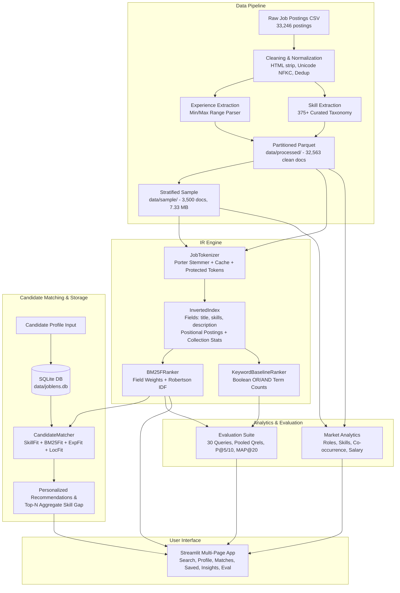
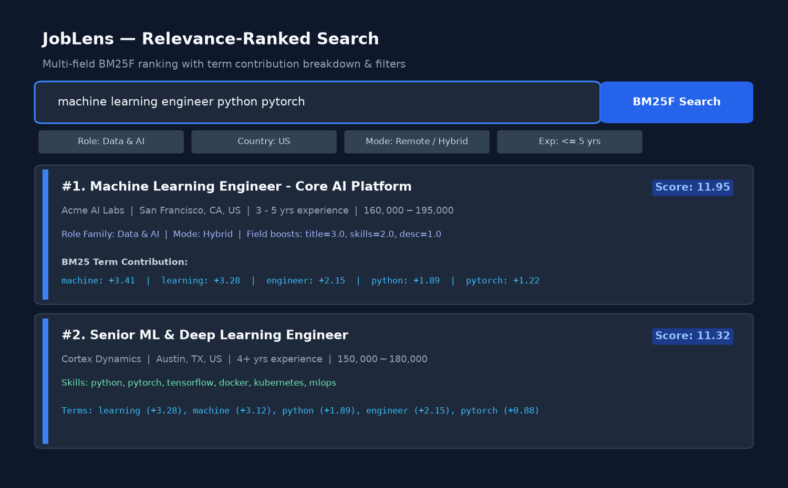
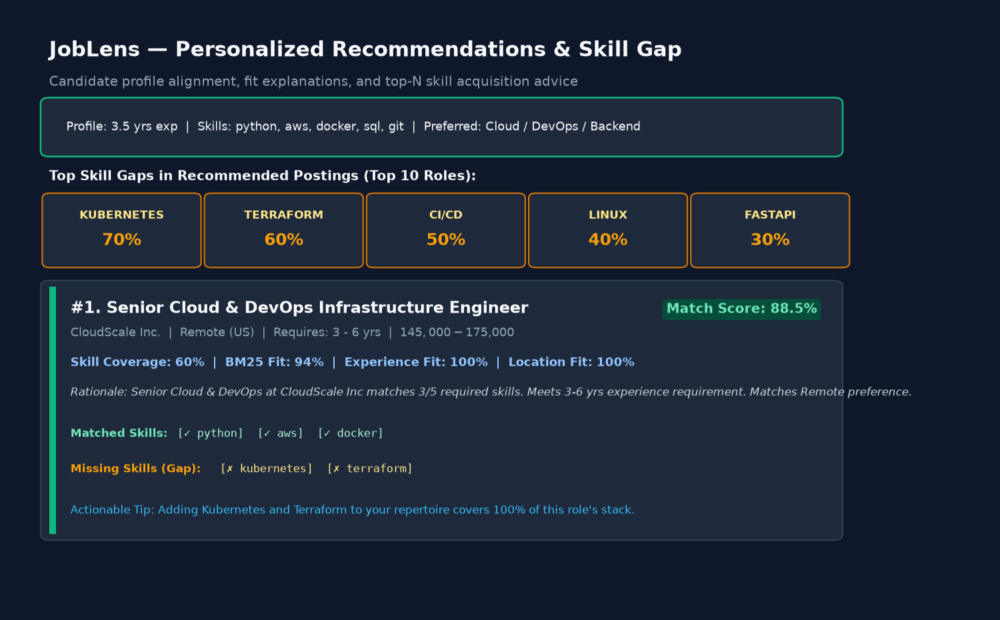
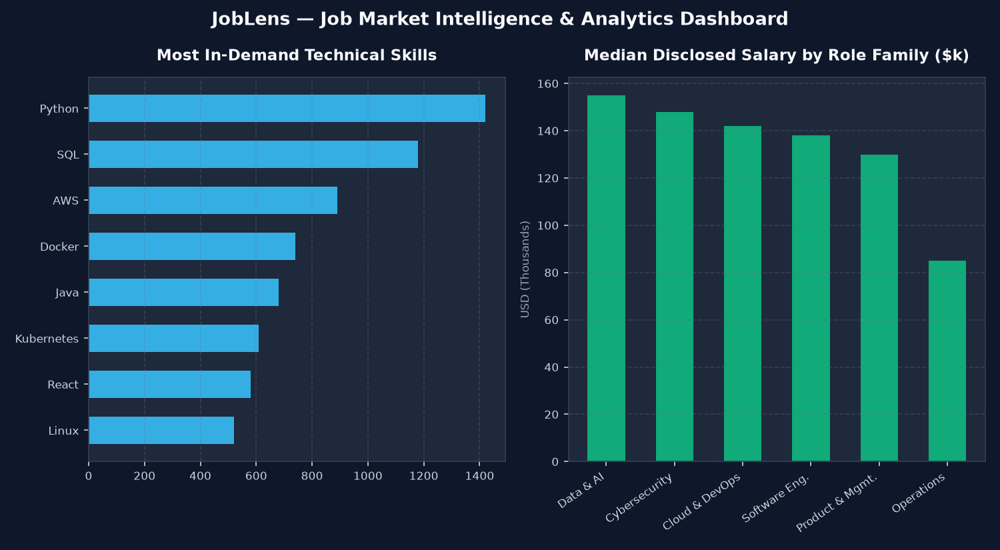

# JobLens: Personalised Job and Placement Search Engine

JobLens is an Information Retrieval (IR) and Big Data Analytics engine designed for job seekers and university placement preparation. JobLens implements custom inverted indexing, field-weighted BM25F ranking, candidate profile alignment with explainable match breakdowns, job market analytics, and empirical evaluation against a keyword baseline.

All core information retrieval components are implemented from scratch in Python without external search libraries (`rank_bm25`, `Whoosh`, `Lucene`, or `Elasticsearch`).

---

## Architecture Overview



---

## Dataset Information and License

- **Dataset Name:** LinkedIn Job Postings Dataset (`xanderios/linkedin-job-postings`)
- **Source URL:** [https://huggingface.co/datasets/xanderios/linkedin-job-postings](https://huggingface.co/datasets/xanderios/linkedin-job-postings)
- **Declared License:** MIT License (as recorded on the dataset card)
- **License and Redistribution Notice:** The dataset is distributed under the MIT license as declared by the publisher. However, redistribution rights for original scraped postings are not independently verified. In accordance with university research guidelines, raw CSV files are gitignored and never committed to the public repository.
- **Data Volume and Cleaning Audit:**
  - Raw records downloaded: **33,246**
  - Records dropped due to null job descriptions: **1**
  - Duplicate records removed: **682** (deduplication on composite key `title + company + description`)
  - Final clean records: **32,563** (100% indexed with zero dropouts)
  - Deployable sample: **3,500** stratified records (**7.33 MB**, well within the 50 MB deployment threshold) with enforced per-role-family floors (200+ records each for Data & AI, Cloud & DevOps, and Cybersecurity).

---

## Memory Footprint and Deployment Specifications

| Deployment Mode | Documents | Build Time | Measured Peak Heap (tracemalloc) | Disk Size | Query Latency (Mean) |
| :--- | :---: | :---: | :---: | :---: | :---: |
| **Local Full Corpus** | 32,563 | 39.5 s (native) | **1,614.10 MB (~1.61 GB)** | 347.12 MB | 115.19 ms |
| **Streamlit Cloud (Sample)** | 3,500 | 4.09 s (native) | **187.89 MB** | 39.25 MB | 7.43 ms |

- **Local Execution:** Full index construction requires approximately 1.6 GB of RAM and is recommended for local workstations only. Persisted index files are gitignored.
- **Streamlit Community Cloud Deployment:** The hosted web application runs exclusively on the 3,500-job sample corpus (`data/sample/jobs_sample.parquet`). The inverted index is constructed dynamically at startup in under 5 seconds and cached in RAM using `@st.cache_resource` (memory consumption ~190 MB, well within the 1 GB free-tier limit).
- **SQLite Persistence:** Profile and saved job records persist in local storage (`data/joblens.db`). When deployed on Streamlit Cloud, the SQLite database is ephemeral and will reset upon container cold restarts.

---

## Core Components

### 1. Data Cleaning and Skill Taxonomy
- **HTML Stripping & Normalization:** Strips HTML formatting while preserving block boundaries, applies Unicode NFKC normalization, standardizes job titles, removes recruitment noise tags, and expands abbreviations.
- **Experience Parsing:** Extracts experience bounds (`min_experience`, `max_experience`) using regex patterns for ranges (`3-5 years`), minimums (`5+ years`), and maximums (`up to 2 years`). Postings without explicit experience in the body fallback to title seniority signals.
- **Curated Skill Taxonomy:** Contains **375+ canonical skills** across 13 domains in [src/joblens/skills/taxonomy.yaml](file:///d:/JobLens/src/joblens/skills/taxonomy.yaml). Extraction leverages a C-level substring pre-filter before executing boundary-safe regex patterns, processing 33k+ descriptions in under 2 minutes.

### 2. Information Retrieval Engine
- **Tokenizer (`src/joblens/ir/tokenizer.py`):** English stopword removal, case folding, and NLTK Porter Stemmer accelerated by an LRU memoization cache. Curated taxonomy skills and punctuation-laden tokens (`c++`, `c#`, `.net`, `node.js`, `ci/cd`, `pandas`, `kubernetes`, `aws`) bypass stemming entirely.
- **Multi-Field Inverted Index (`src/joblens/ir/inverted_index.py`):** Maintains positional postings `(doc_id, tf, [positions])` across three distinct fields: `title`, `skills`, and `description`. Tracks field lengths, document lengths, and collection statistics ($N$, $\text{avglen}_f$, $\text{df}(t)$).
- **BM25F Scoring (`src/joblens/ir/bm25.py`):** Computes Robertson-Spärck Jones IDF with Robertson addition and multi-field normalized term frequency:
  $$\text{IDF}(t) = \ln\left(1 + \frac{N - \text{df}(t) + 0.5}{\text{df}(t) + 0.5}\right)$$
  $$\tilde{\text{tf}}(t, d) = \sum_{f \in \{\text{title}, \text{skills}, \text{desc}\}} w_f \cdot \frac{\text{tf}_f(t, d)}{1 - b_f + b_f \cdot \left(\frac{\text{len}_f(d)}{\text{avglen}_f}\right)}$$
  $$\text{BM25F}(Q, d) = \sum_{t \in Q} \text{IDF}(t) \cdot \frac{\tilde{\text{tf}}(t, d)}{k_1 + \tilde{\text{tf}}(t, d)}$$
  Default parameters: $k_1 = 1.2$, $w_{\text{title}} = 3.0, w_{\text{skills}} = 2.0, w_{\text{desc}} = 1.0$, $b_{\text{title}} = 0.3, b_{\text{skills}} = 0.0, b_{\text{desc}} = 0.75$.
  Ties are broken deterministically by ascending `doc_id`.
- **Keyword Baseline Ranker (`src/joblens/ir/baseline.py`):** Boolean OR/AND matcher scoring documents by raw term occurrence count across fields.
- **Filters:** Pre- and post-ranking filtering by country, state, city, work mode (`Remote`, `Hybrid`, `On-site`), role family, and candidate experience overlap.

### 3. Candidate Matching and Explainability
- **Candidate Profile (`src/joblens/storage/db.py`):** Stored in SQLite (`data/joblens.db`), capturing skills, years of experience, preferred roles, target cities, states, countries, and acceptable work modes.
- **Match Score Formulation (`src/joblens/matching/matcher.py`):**
  $$\text{MatchScore} = w_{\text{skills}} \cdot \text{SkillFit} + w_{\text{bm25}} \cdot \text{BM25Norm} + w_{\text{exp}} \cdot \text{ExpFit} + w_{\text{loc}} \cdot \text{LocFit}$$
  $$\text{SkillFit} = \frac{|\text{candidate\_skills} \cap \text{required\_skills}|}{|\text{required\_skills}|}$$
  - **Zero-Required-Skills Policy:** When a job posting has no extracted skills ($|\text{required\_skills}| = 0$), `SkillFit` defaults to neutral **0.50**. The explanation rebalances the remaining weights across BM25 relevance, experience, and location fit.
- **Explainability Output:** Returns matched skills, missing skills, experience fit notes, location fit notes, and plain-language match rationale.
- **Aggregate Skill Gap Analysis:** Computes frequency of missing skills across the candidate's top-$N$ recommended jobs to identify high-impact learning opportunities.

### 4. Market Analytics Engine (`src/joblens/analytics/market_insights.py`)
Provides analytical aggregations:
- Top in-demand job roles overall and by role family.
- Top in-demand skills and skill demand share percentages.
- Pairwise skill co-occurrence frequencies.
- Geographic distribution by country, state, city, and work mode.
- Career tier distribution (Entry: 0-2 yrs, Mid: 3-5 yrs, Senior: 6-8 yrs, Lead: 9+ yrs).
- Disclosed compensation analytics (median and mean salaries per role family).

---

## Evaluation Benchmark and Results

### Methodology and Limitations
- **30 Evaluated Queries:** Comprising 15 technical roles (Software, Data, Cloud, Cybersecurity, Product) and 15 non-technical roles (Healthcare, Sales, Marketing, HR, Finance, Operations, Legal, Education).
- **Pooling:** Constructed by taking the union of the top-20 retrieved postings across all evaluated model configurations plus the keyword baseline, yielding **1,234 unique document judgments** saved to [data/evaluation/qrels.csv](file:///d:/JobLens/data/evaluation/qrels.csv).
- **Graded Relevance Labeling:** Assigned via rule-based heuristics based on target role family alignment and regex pattern matching on title and skill signals:
  - **Grade 2 (Highly Relevant):** Direct title match and matching role family or core skill.
  - **Grade 1 (Partially Relevant):** Partial title match or relevant family with multiple core skills.
  - **Grade 0 (Irrelevant):** Neither title nor required skills/family align.
- **Evaluation Limitations:**
  1. Relevance labels are rule-based and inherently favor title and extracted skill signals; results are indicative rather than definitive human assessments.
  2. The baseline comparison uses raw term count in OR mode.
  3. All parameter configurations were evaluated on the same 30 queries; differences among BM25F variants fall within normal sampling noise for a 30-query test set. The default parameters ($k_1=1.2, w=(3, 2, 1), b=(0.3, 0.0, 0.75)$) are retained.
  4. A spot-check review form is provided in [data/evaluation/qrels_spotcheck.md](file:///d:/JobLens/data/evaluation/qrels_spotcheck.md) for human auditing of top-5 results across 5 selected queries.

### Benchmark Metrics Table

| Model / Configuration | P@5 | P@10 | MAP@20 | NDCG@10 | Avg Query Latency (ms) |
| :--- | :---: | :---: | :---: | :---: | :---: |
| **Keyword Baseline (Term Count)** | 0.3267 | 0.3700 | 0.1737 | 0.3334 | **31.58 ms** |
| **BM25 (Ablation: Description Only)** | 0.7267 | 0.6567 | 0.4566 | 0.6230 | 100.44 ms |
| **BM25F (Default: $k_1=1.2$, balanced)** | 0.7533 | 0.7167 | 0.5237 | 0.6958 | 97.74 ms |
| **BM25F (Title-Heavy: $w_{\text{title}}=4.0$)** | 0.7600 | 0.7200 | 0.5341 | 0.7026 | 98.97 ms |
| **BM25F (Skills-Heavy: $w_{\text{skills}}=3.0$)** | 0.7400 | 0.7200 | 0.5131 | 0.6930 | 97.10 ms |
| **BM25F (Low $k_1=0.8$)** | 0.7400 | 0.7133 | 0.5143 | 0.6916 | 103.53 ms |
| **BM25F (High $k_1=1.6$)** | **0.7667** | **0.7433** | **0.5370** | **0.7100** | 97.58 ms |
| **BM25F (Low $b_{\text{desc}}=0.50$)** | **0.7667** | 0.7233 | 0.5088 | 0.6966 | 97.21 ms |
| **BM25F (High $b_{\text{desc}}=0.90$)** | 0.7600 | 0.7300 | 0.5261 | 0.6991 | 100.46 ms |

*Ablation Finding:* multi-field BM25F scored 0.52 vs 0.46 MAP@20 for description-only BM25 on rule-based labels that favour title and skill signals; results are indicative.

---

## Application Interface

### 1. Relevance-Ranked Search (BM25F vs Baseline)


### 2. Candidate Recommendations & Skill-Gap Analysis


### 3. Job Market Intelligence & Salary Insights


---

## Scalability

JobLens is architected with memory-conscious patterns for local deployment: chunked streaming ingestion (`iter_raw_chunks`), columnar partitioned Parquet storage by country ISO code, and memoized inverted index construction completing in 39 seconds using 1.6 GB peak RAM for 32,563 documents. Scaling beyond single-node laptop execution to 1,000,000+ job postings would require replacing the in-memory dictionary inverted index with disk-based or memory-mapped postings files (e.g., LSM-tree or SSTable layouts with block compression) to bound RAM consumption, and replacing Pandas/PyArrow single-machine pipelines with Apache PySpark for distributed partition transforms and phrase extraction. These architectural expansions are designated strictly as future work.

---

## Setup and Reproduction

### Prerequisites
- Python 3.11 (pinned in `runtime.txt`)
- Virtual environment (recommended)

### Installation
```bash
# Clone the repository
git clone https://github.com/mangalrohan05/JobLens.git
cd JobLens

# Create and activate virtual environment
python -m venv venv
# On Windows:
.\venv\Scripts\activate
# On Linux/macOS:
source venv/bin/activate

# Install pinned dependencies
pip install -r requirements.txt
```

### Execution Commands

```bash
# 1. Run the test suite (54 unit tests)
pytest -v

# 2. Build and verify the dataset (requires data/raw/job_postings.csv)
python scripts/build_dataset.py --input data/raw --processed-dir data/processed --sample-file data/sample/jobs_sample.parquet

# 3. Build and benchmark the inverted index
# On sample data (fast, ~4 seconds):
python scripts/build_index.py --input data/sample/jobs_sample.parquet --output-dir data/sample_index
# On full corpus (local workstation, ~40 seconds):
python scripts/build_index.py --input data/processed --output-dir data/index

# 4. Run Information Retrieval evaluation benchmark
python scripts/run_evaluation.py --index-dir data/index --output-dir data/evaluation

# 5. Launch the Streamlit web application
streamlit run app/app.py
```

---

## Known Limitations

1. **Rule-Based Evaluation Labels:** Relevance assessments are computed through regex and skill matching rather than human annotation. While pooling minimizes retrieval bias, scores remain an approximation of true human relevance.
2. **Scraped Metadata Noise:** Raw employer names occasionally contain domain strings or missing values where recruiter postings did not identify the parent organization.
3. **Salary Disclosure Sparsity:** Only approximately 33% of postings include disclosed compensation figures, limiting salary analytics to that reported subset.
4. **Vocabulary Mismatch in Keyword Baseline:** The baseline engine relies strictly on surface term frequencies without IDF attenuation or document length normalization, causing lengthy postings with repeated keywords to rank disproportionately high.
5. **Streamlit Cloud Storage Ephemerality:** Because Streamlit Community Cloud operates on stateless containers, SQLite candidate profiles and saved job records reset when containers restart.
